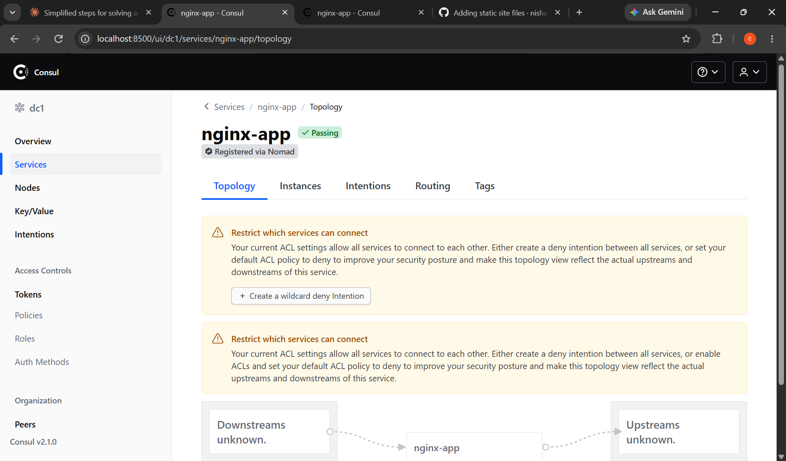

# DevOps Intern Final Assessment

- **Name:** Emeka Godwin Chukwuemeka
- **Submission date:** 11 November 2026
- **Repository:** https://github.com/chukwuemekagodwin56/devops-intern-final
- **Release:** v1.0.0

## 1. Architecture overview

A small static website is served by NGINX inside a container. Every push goes through a CI pipeline (GitHub Actions), the image is published to GitHub Container Registry (GHCR), Nomad runs it and registers it in Consul, and Promtail ships its logs to Loki so they can be searched in Grafana.

~~~
 Source (GitHub repo)
        |
        v
 CI: GitHub Actions  (lint -> build -> test -> publish)
        |
        v
 Registry: ghcr.io/chukwuemekagodwin56/devops-intern-final
        |
        v
 Nomad (docker driver) + Consul (service + health check)
        |  container logs
        v
 Promtail -> Loki -> Grafana (Explore)
~~~

The starting application was: written from scratch as a minimal static page.

## 2. Prerequisites (pinned versions)

Tested on Ubuntu under WSL2 on Windows.

| Tool | Version used |
|---|---|
| Docker | version 29.9.3, build 5457199 |
| Docker Compose | version v5.7.0 |
| Nomad | v2.1.1 |
| Consul | v2.1.0 |
| ShellCheck | version: 0.9.0 |
| Git | version 2.43.0 |
| curl and jq | any recent version |

## 3. Quick Start (clone to running app)

~~~bash
git clone https://github.com/chukwuemekagodwin56/devops-intern-final.git
cd devops-intern-final
docker build --build-arg BUILD_SHA=$(git rev-parse --short HEAD) -t nginx-app:local app/
docker run -d --name nginx-app -p 8080:8080 nginx-app:local
./scripts/healthcheck.sh
curl -i http://localhost:8080/
~~~

Stop it afterwards with `docker rm -f nginx-app`. Deploying with Nomad and starting the log stack are described in sections 8 and 9.

## 4. Task 1: Source control

- Public repo `devops-intern-final`, built up in small commits with conventional messages (`feat:`, `ci:`, `docs:`).
- Work was done on `feature/*` branches and merged into `main` through pull requests, each with a short self-review.
- `.gitignore` excludes IDE metadata (`.idea/`, `.vscode/`), logs and secrets.
- The final state is tagged `v1.0.0`.

Commit history:

~~~
8f0b8a7 Merge pull request #3 from chukwuemekagodwin56/feature/nomad
aefb97b feat: add loki, promtail and grafana log stack
550572d feat: add nomad job spec for nginx app
fe30ca2 Merge pull request #1 from chukwuemekagodwin56/feature/app
8f02b1b ci: add lint, build, test and publish pipeline
e0c6fc1 feat: add dockerfile and nginx config with healthz endpoint
d51ea48 feat: add sysinfo and healthcheck scripts
fc0e466 feat: add static index page with name, date and build id
480939e docs: add project structure and gitignore
c976682 feat: add dockerfile
~~~

## 5. Task 2: Linux scripting

Both scripts start with a shebang and `set -euo pipefail`. I used `#!/usr/bin/env bash` because `pipefail` is not part of strict POSIX `sh`. Both pass ShellCheck and are executable in Git (mode 100755).

~~~bash
shellcheck scripts/*.sh
git ls-files --stage scripts/
~~~

Sample output of `./scripts/sysinfo.sh`:

~~~
Kernel release: 6.18.58.1-microsoft-standard-WSL2
Date (ISO-8601): 2026-11-11T14:30:08+01:00
--- Disk usage ---
Filesystem                                Size  Used Avail Use% Mounted on
none                                      3.8G     0  3.8G   0% /usr/lib/modules/6.18.58.1-microsoft-standard-WSL2
/dev/sdb                                   97M   97M     0 100% /usr/src/linux-headers-6.18.58.1-microsoft-standard-WSL2
none                                      3.8G   23M  3.8G   1% /mnt/wsl
drivers                                   452G  395G   58G  88% /usr/lib/wsl/drivers
/dev/sdd                                 1007G  4.7G  951G   1% /
none                                      3.8G   40K  3.8G   1% /mnt/wslg
none                                      3.8G     0  3.8G   0% /usr/lib/wsl/lib
rootfs                                    3.8G  3.4M  3.8G   1% /init
none                                      3.8G   24M  3.8G   1% /run
none                                      3.8G     0  3.8G   0% /run/lock
none                                      3.8G     0  3.8G   0% /run/shm
none                                      3.8G   80K  3.8G   1% /mnt/wslg/versions.txt
none                                      3.8G   80K  3.8G   1% /mnt/wslg/doc
C:\                                       452G  395G   58G  88% /mnt/c
D:\                                       8.0G  2.0G  6.1G  25% /mnt/d
tmpfs                                     777M   20K  777M   1% /run/user/1001
tmpfs                                     1.0M     0  1.0M   0% /tmp/NomadClient2413634060/04fd88e1-6dbd-fbf6-f84d-67eef4f25eed/nginx/secrets
tmpfs                                     1.0M     0  1.0M   0% /tmp/NomadClient2413634060/04fd88e1-6dbd-fbf6-f84d-67eef4f25eed/nginx/private
none                                      3.8G  508K  3.8G   1% /mnt/wsl/docker-desktop/shared-sockets/host-services
/dev/loop0                                793M  793M     0 100% /mnt/wsl/docker-desktop/cli-tools
tmpfs                                     777M   20K  777M   1% /run/user/0
C:\Program Files\Docker\Docker\resources  452G  395G   58G  88% /Docker/host
--- Memory usage ---
               total        used        free      shared  buff/cache   available
Mem:           7.6Gi       1.8Gi       2.8Gi        50Mi       3.1Gi       5.8Gi
Swap:          2.0Gi          0B       2.0Gi
--- Docker daemon ---
Docker daemon: running
~~~

Healthcheck against a working URL, then against a failing one:

~~~
Checking https://example.com ...
OK: https://example.com returned 200
Exit code: 0
Checking http://localhost:8080 ...
FAIL: http://localhost:8080 returned '000' (expected 200)
Exit code: 1
~~~

## 6. Task 3: Containerisation

Design choices:
- Pinned base image `nginx:1.27-alpine` (never `latest`).
- Custom `nginx.conf` serving on port 8080 with a `/healthz` endpoint that returns 200.
- Runs as the non-root `nginx` user (pid and temp files live in `/tmp`).
- `EXPOSE 8080` and a `HEALTHCHECK` that calls `/healthz`.
- `BUILD_SHA` build argument is written into the page and into an `X-Build-SHA` response header.

Commands:

~~~bash
docker build --build-arg BUILD_SHA=$(git rev-parse --short HEAD) -t nginx-app:local app/
docker run -d --name nginx-app -p 8080:8080 nginx-app:local
~~~

Image size (must be under 60 MB):

~~~
IMAGE             ID             DISK USAGE   CONTENT SIZE   EXTRA
nginx-app:local   4ecd97162155       73.7MB           21MB 
~~~

Responses:

~~~
HTTP/1.1 200 OK
Server: nginx/1.27.5
Date: Wed, 11 Nov 2026 13:53:12 GMT
Content-Type: text/html
Content-Length: 238
Last-Modified: Wed, 11 Nov 2026 13:48:51 GMT
Connection: keep-alive
ETag: "6af47243-ee"
X-Build-SHA: 8f0b8a7
Accept-Ranges: bytes

<!DOCTYPE html>
<html>
<head>
  <title>DevOps Intern Final</title>
</head>
<body>
  <h1>DevOps Intern Final Assessment</h1>
  
Name: Emeka Godwin Chukwuemeka

  
Date: 9 November 2026

  
Build ID: 8f0b8a7

</body>
</html>
HTTP/1.1 200 OK
Server: nginx/1.27.5
Date: Wed, 11 Nov 2026 13:53:12 GMT
Content-Type: text/plain
Content-Length: 3
Connection: keep-alive
X-Build-SHA: 8f0b8a7

ok
nginx
CONTAINER ID   IMAGE             COMMAND                  CREATED         STATUS                   PORTS                                         NAMES
00b408b2126f   nginx-app:local   "/docker-entrypoint.…"   6 minutes ago   Up 6 minutes (healthy)   0.0.0.0:8080->8080/tcp, [::]:8080->8080/tcp   nginx-app
~~~

## 7. Task 4: Continuous integration

`.github/workflows/ci.yml` runs on push and pull request to `main` with four jobs:

1. **lint**: ShellCheck on `scripts/` and Hadolint on `app/Dockerfile`.
2. **build**: builds the image with `BUILD_SHA=${{ github.sha }}`.
3. **test**: starts the container, waits for `/healthz`, then runs `scripts/healthcheck.sh`. The job fails if the endpoint does not return 200.
4. **publish**: on push to `main` only, pushes the image to `ghcr.io` tagged with the commit SHA and `latest`.

Security: third-party actions are pinned to major versions, the workflow uses the built-in `GITHUB_TOKEN` (no stored credentials), top-level permissions are `contents: read`, and only the publish job has `packages: write`.

Published image: https://github.com/chukwuemekagodwin56/devops-intern-final/pkgs/container/devops-intern-final

## 8. Task 5: Orchestration with Nomad

`nomad/nginx-app.nomad.hcl` is a `service` job with one group and one task using the `docker` driver. The image is pulled from GHCR by tag, and the tag is an HCL variable (`image_tag`). I deployed the commit SHA, not `latest`.

- Resources: 100 MHz CPU and 64 MB memory (no deviation).
- Dynamic port named `http`, mapped to container port 8080.
- Consul service registration with an HTTP check on `/healthz` (interval 10s, timeout 2s).
- Rolling update: `max_parallel = 1`, `min_healthy_time = 10s`, `healthy_deadline = 2m`, `auto_revert = true`.
- `restart` and `reschedule` policies.

Commands (Consul and Nomad run in dev mode in separate terminals):

~~~bash
consul agent -dev
sudo nomad agent -dev
8f0b8a7d27d410fb25fdc2a3d463f001fae3a2e3
nomad job validate -var image_tag=$IMAGE_TAG nomad/nginx-app.nomad.hcl
nomad job plan -var image_tag=$IMAGE_TAG nomad/nginx-app.nomad.hcl
nomad job run -var image_tag=$IMAGE_TAG nomad/nginx-app.nomad.hcl
nomad job status nginx-app
~~~

Observed output:

~~~
Job Warnings:
1 warning:

* group "web" defines services, but neither the group nor any of its tasks have shutdown_delay set

Job validation successful
Job: "nginx-app"
Task Group: "web" (1 ignore)
  Task: "nginx"

Scheduler dry-run:
- All tasks successfully allocated.

Job Warnings:
1 warning:

* group "web" defines services, but neither the group nor any of its tasks have shutdown_delay set

Job Modify Index: 11
To submit the job with version verification run:

nomad job run -check-index 11 -var="image_tag=8f0b8a7d27d410fb25fdc2a3d463f001fae3a2e3" nomad/nginx-app.nomad.hcl

When running the job with the check-index flag, the job will only be run if the
job modify index given matches the server-side version. If the index has
changed, another user has modified the job and the plan's results are
potentially invalid.
Job Warnings:
1 warning:

* group "web" defines services, but neither the group nor any of its tasks have shutdown_delay set

==> View this job in the Web UI: http://127.0.0.1:4646/ui/jobs/nginx-app@default

==> 2026-11-11T15:13:45+01:00: Monitoring evaluation "d1048616"
    2026-11-11T15:13:45+01:00: Evaluation triggered by job "nginx-app"
    2026-11-11T15:13:45+01:00: Evaluation within deployment: "5f9fd743"
    2026-11-11T15:13:45+01:00: Evaluation status changed: "pending" -> "complete"
==> 2026-11-11T15:13:45+01:00: Evaluation "d1048616" finished with status "complete"
==> 2026-11-11T15:13:45+01:00: Monitoring deployment "5f9fd743"
  ✓ Deployment "5f9fd743" successful
    
    2026-11-11T15:13:45+01:00
    ID          = 5f9fd743
    Job ID      = nginx-app
    Job Version = 0
    Status      = successful
    Description = Deployment completed successfully
    
    Deployed
    Task Group  Auto Revert  Desired  Placed  Healthy  Unhealthy  Progress Deadline
    web         true         1        1       1        0          2026-11-11T13:15:27+01:00
ID            = nginx-app
Name          = nginx-app
Submit Date   = 2026-11-11T13:05:08+01:00
Type          = service
Priority      = 50
Datacenters   = dc1
Namespace     = default
Node Pool     = default
Status        = running
Periodic      = false
Parameterized = false

Summary
Task Group  Queued  Starting  Running  Failed  Complete  Lost  Unknown
web         0       0         1        0       0         0     0

Latest Deployment
ID          = 5f9fd743
Status      = successful
Description = Deployment completed successfully

Deployed
Task Group  Auto Revert  Desired  Placed  Healthy  Unhealthy  Progress Deadline
web         true         1        1       1        0          2026-11-11T13:15:27+01:00

Allocations
ID        Node ID   Task Group  Version  Desired  Status   Created   Modified
04fd88e1  404b211a  web         0        run      running  2h9m ago  2h8m ago

==> View job details and metrics in the Web UI: http://127.0.0.1:4646/ui/jobs/nginx-app@default
~~~

Testing the allocation (the host port is dynamic, so it was read from `nomad alloc status 04fd88e1`):

~~~
HTTP/1.1 200 OK
Server: nginx/1.27.5
Date: Wed, 11 Nov 2026 14:46:45 GMT
Content-Type: text/plain
Content-Length: 3
Connection: keep-alive
X-Build-SHA: 8f0b8a7d27d410fb25fdc2a3d463f001fae3a2e3

ok
Checking http://127.0.0.1:25908 ...
OK: http://127.0.0.1:25908 returned 200
~~~

## 9. Task 6: Log aggregation with Loki

Start the stack:

~~~bash
cd monitoring
docker compose up -d
docker compose ps
curl -s http://localhost:3100/ready
~~~

- `loki-config.yaml` and `promtail-config.yaml` are committed, not pulled at runtime.
- Promtail reads Docker container logs and keeps only the Nomad container named `nginx-<allocation-id>`.
- Labels: `job`, `service`, `container`, `nomad_alloc_id` (Loki also adds `service_name`).
- Query used to isolate errors after requesting missing pages: `{job="nginx-app"} |= " 404 "`.

Full details, queries, results and problems are in [monitoring/loki_setup.md](monitoring/loki_setup.md).

## 10. Troubleshooting (failures I actually hit)

| Problem | Cause | Fix |
|---|---|---|
| WSL printed `Processing /etc/fstab with mount -a failed` at start | `/etc/fstab` had a mount line for a disk that does not exist in WSL | Commented out that line with a `#`, then ran `wsl --shutdown` |
| `permission denied ... /var/run/docker.sock` during `docker build` | My user was not in the `docker` group | `sudo usermod -aG docker $USER`, then `newgrp docker` |
| Grafana at `localhost:3000` showed "Unauthorized" | The browser was not logged in, and the bare URL gave an auth error instead of the login page | Opened http://localhost:3000/login and signed in with the default admin account |
| Nomad job commit landed on `main` instead of a feature branch | I committed before creating the branch | Fast-forwarded `feature/nomad` to the commit and reset local `main` with `git branch -f main origin/main` |
| `curl` URL pasted with `< >` brackets gave a shell syntax error | The brackets were placeholders, and the shell treats `<` and `>` as redirects | Used the plain address, e.g. `http://127.0.0.1:24013/healthz` |

(Delete any row that did not happen to you. Keep at least three real ones.)

## 11. Known Limitations

This is a learning project and is not production-ready. Honestly:
- Nomad and Consul run in **dev mode** on one machine: no clustering, no ACLs, no TLS, no persistent state.
- Grafana has **anonymous admin access** enabled for convenience; this must be disabled in real use.
- Only **one replica** runs, so there is no real high availability, and a rolling update has only one instance to roll.
- The image is also pushed with the `latest` tag in CI (required by the task), but the Nomad job deploys by commit SHA.
- The site is served over **plain HTTP** with no TLS.
- Loki uses local filesystem storage with **no retention policy, backups or alerting**.
- Promtail depends on the Docker socket and on the container name pattern, which is fragile.
- The Nomad job is deployed **manually**; there is no automated CD from CI to Nomad.

With more time I would add TLS through a reverse proxy, deploy Nomad automatically from CI, add metrics and alerts, and run multiple replicas on a real cluster.
